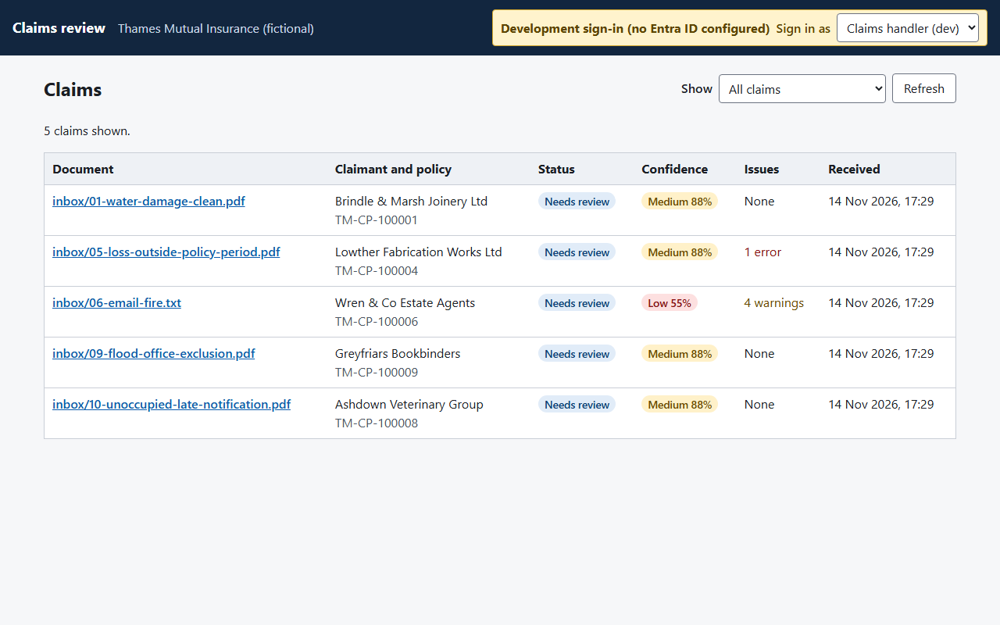
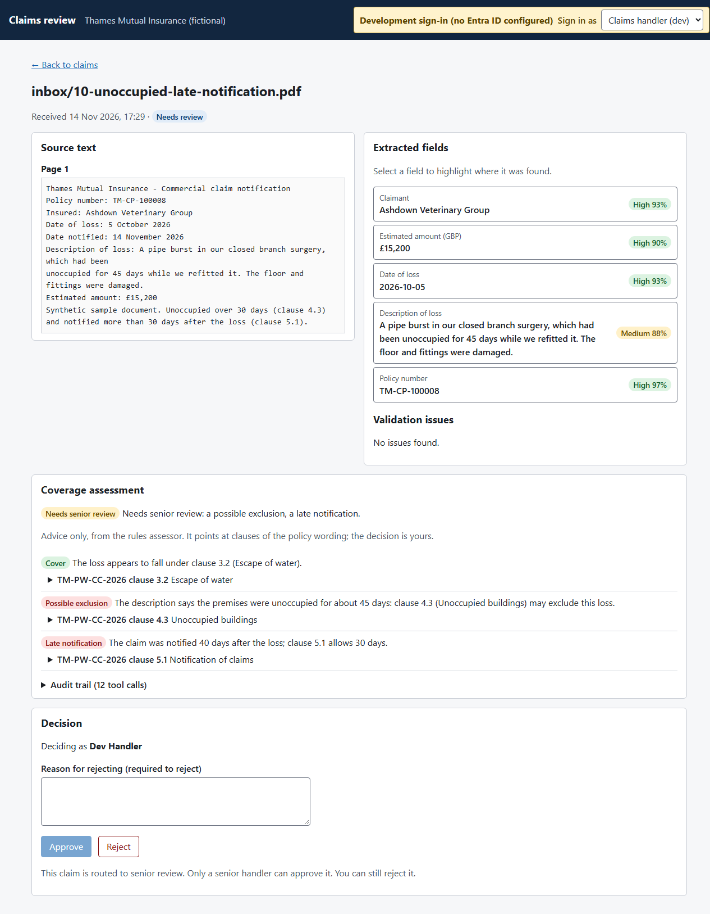
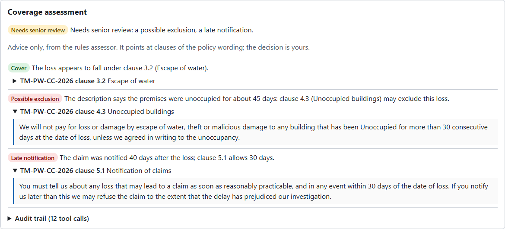
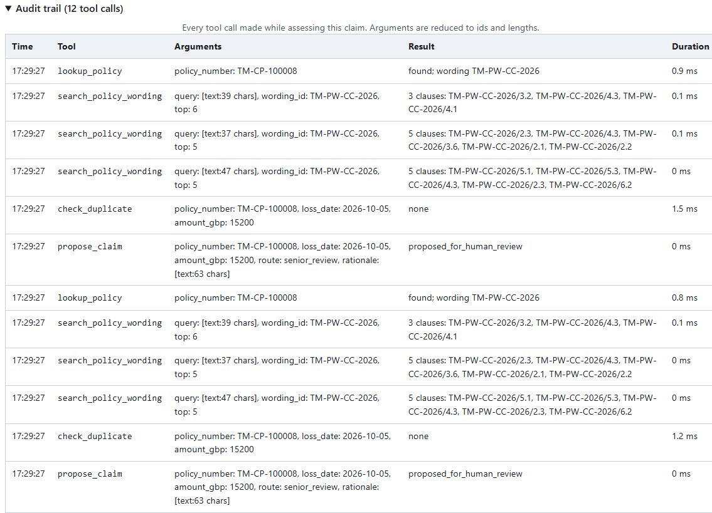
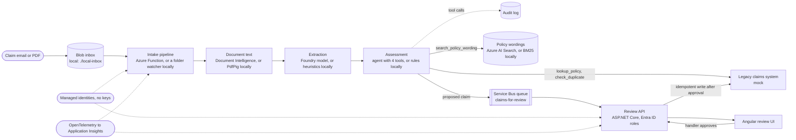

# Claims Intake Accelerator

<!-- DEMO VIDEO: when the 3-minute recording exists, put its link on the next line as: **Demo video (3 minutes):** <url>. Script: docs/demo-script.md -->

A UK commercial insurer receives claims as messy emails and PDFs, and handlers spend 10 to 20 minutes per claim reading each one and
re-keying it into the claims system, with typing errors that surface later as rework. This is a reference implementation of the
pipeline that removes the re-keying: it reads the document, extracts the claim, checks it against the policy wording and quotes the
clauses that matter, and puts a pre-filled claim in front of a handler. **A person approves every write to the claims system.** It is built
on Azure and .NET 10, runs fully offline on a laptop, and is written up the way a customer engagement would be: discovery, agreed success
metrics, design decisions, a threat model, tests, CI and infrastructure as code.

> **Thames Mutual Insurance is a fictional customer.** The scenario, people, policies and figures are invented for this portfolio
> project. No real claim data is used or needed.
>
> **Read this first.** Nothing here has been deployed to Azure or run against a real model or a real Entra ID tenant. All the numbers
> below come from the offline heuristic and rules pipeline on synthetic data. The detail is in [Verified and not verified](#verified-and-not-verified).

## What this demonstrates

| Theme | What is here | Start with |
|---|---|---|
| **Production-grade and secure** | Entra ID authentication on every endpoint, app roles with segregation of duties enforced in the domain, a decision audit, one managed identity per component with a role matrix checked in CI, no keys or connection strings, a STRIDE threat model, and an independent review whose 42 findings were worked through in Milestone 6 | [security posture](docs/security-posture.md), [threat model](docs/threat-model.md), [review](docs/reviews/2026-11-architecture-security-review.md), [ADR 0009](docs/adr/0009-identity-roles-and-segregation-of-duties.md) |
| **Success metrics agreed with the customer** | A discovery note and five outcome metrics plus five guardrails, each with a baseline, a target and a way to measure it, then measured results against them, including the one guardrail that is not met | [discovery](docs/00-discovery.md), [success metrics](docs/01-success-metrics.md), [engagement summary](docs/engagement-summary.md) |
| **CI/CD and observability** | GitHub Actions for build, test, UI, an evaluation gate that fails below threshold, Bicep compile and lint, role matrix, SBOM, CodeQL and dependency review; OpenTelemetry with one trace from intake to review, metrics, alerts and a workbook | [ci.yml](.github/workflows/ci.yml), [Telemetry](src/ClaimsIntake.Api/Telemetry/TelemetryExtensions.cs), [alerts](infra/modules/alerts.bicep), [workbook](infra/workbooks/claims-intake.workbook.json) |
| **Reusable reference implementation** | Every external dependency is behind an interface with a local and an Azure implementation, chosen by configuration. Bicep and an `azd` project for the Azure side, with a first-deployment runbook | [ADR 0005](docs/adr/0005-local-development-mode.md), [infra](infra/README.md), [azure.yaml](azure.yaml), [deploy runbook](docs/runbook-deploy.md) |
| **RAG, evaluation, model selection, data quality** | Clause-level policy wording search with a citation guard, 58 synthetic cases with ground truth and a scorer, input-quality checks that route unreadable documents to a person, and a model comparison harness with written decision rules | [ADR 0006](docs/adr/0006-policy-wording-rag.md), [evals](evals/README.md), [ADR 0007](docs/adr/0007-evaluation-approach.md), [ADR 0008](docs/adr/0008-model-selection-and-tuning.md) |

## Headline numbers

**What was measured:** the offline heuristic extractor and rules assessor (no model, no network) on the 40-case held-out test split of a
synthetic dataset, written by the same author as the extractor. These figures flatter the system and are not real-model results. No
real-model number exists anywhere in this repository. Source: [evals/results/baseline/report.md](evals/results/baseline/report.md), which the CI gate
re-checks on every push.

| Measure | Result | Customer target ([success metrics](docs/01-success-metrics.md)) |
|---|---|---|
| Field F1, six fields, overall | **0.969** | 0.95 or more |
| Field F1, policy number and loss date | 0.985 and 0.985 | 0.98 |
| Field F1, cause of loss (weakest) | 0.885 | none set |
| Route accuracy (the claim goes to the right place) | **87.5%** (35 of 40) | none set |
| Citation groundedness (clause exists and the quoted text matches) | **100%** of 32 citations, by construction for the rules assessor | 0.90 or more |
| Claims needing no data repair | 70.0% (truth 72.5%) | 60% or more |
| Auto-routable to a handler, and right when it was | 37.5% (truth 47.5%); 93.3% precision | none set |
| Claims that raised no flag but had a wrong critical field | **5.9%** (1 of 17) | 1% or fewer: **not met** |
| Cost per claim | £0.00 (no model) | £0.60 or less: not meaningful yet |
| p95 time to process a claim | 2.6 ms in process (no model, no network) | 90 s: not meaningful yet |

Tests: 845 .NET (Domain 116, API 208, Pipeline 377, Evals 144), 60 UI (Vitest) and 14 Python (11 of them need a Bicep CLI and are skipped without one), all passing; the build has 0 warnings.

## What it looks like

The Angular review UI, running locally with the development sign-in. The screenshots were taken from a real run in headless Microsoft Edge.



A claim routed to senior review: the source text beside the extracted fields, confidence per field, the coverage findings and the decision panel.
The assessment is advice; the Approve button is disabled for a claims handler because only a senior handler may approve this route.



Each finding cites a clause of the policy wording, and the text shown is the wording's own, never the model's. Here the loss is covered under 3.2,
but the premises were unoccupied for 45 days (exclusion 4.3) and the claim was notified late (condition 5.1).



Every tool call the assessor made is in the audit trail, with arguments reduced to ids and lengths. (In local mode each call appears twice: the rules assessor also runs as the route floor, and the trail records both runs. A known quirk, not a bug in the data.)



The API enforces the same rule: approving that claim as the claims handler returns 403, and with no token 401.

## Architecture



The same pipeline code runs in both modes, and only the edges change ([ADR 0005](docs/adr/0005-local-development-mode.md)). Locally, the
hand-off is an HTTP call instead of a queue message. The agent can only propose: the tools have no writer, and a test checks it
([ADR 0002](docs/adr/0002-human-approval-for-writes.md)). The full diagram, a component table with the status of each part, and the trust
boundaries are in [docs/architecture.md](docs/architecture.md).

## Quickstart

You need the [.NET 10 SDK](https://dotnet.microsoft.com/download) and [Node.js](https://nodejs.org) 22 or later. No Azure account, keys or Docker.
The commands below are PowerShell on Windows; the `dotnet` and `npm` lines work unchanged in any shell.

```powershell
git clone https://github.com/varrunss/claims-intake-accelerator.git
cd claims-intake-accelerator

dotnet restore --locked-mode
dotnet build --no-restore
dotnet test --no-build                       # 845 tests
dotnet run --project evals/ClaimsIntake.Evals -- --split test --thresholds evals/thresholds.json   # the evaluation gate, offline, a few seconds

cd ui; npm ci; npm test; npm run build; cd ..   # 60 UI tests, then a production build
```

Then run the whole system (legacy mock, review API, inbox watcher and the UI, with the development sign-in):

```powershell
powershell -NoProfile -ExecutionPolicy Bypass -File scripts/run-local.ps1
```

`-ExecutionPolicy Bypass` applies to that one process only and changes no setting; it is needed because the script is not signed. The
script builds, starts the four processes, and waits until they answer. In a second terminal, drop in a sample and look at the result:

```powershell
Copy-Item samples/01-water-damage-clean.pdf, samples/10-unoccupied-late-notification.pdf local-inbox/
curl.exe -H "Authorization: Bearer dev-handler" "http://localhost:5100/claims?status=all"
```

Open <http://localhost:4200>. Sample 10 is routed to senior review: as the claims handler the Approve button is disabled and the API answers 403,
and the "Sign in as" selector at the top switches to the senior handler. Stop everything with Ctrl+C, or from another terminal:

```powershell
powershell -NoProfile -ExecutionPolicy Bypass -File scripts/run-local.ps1 -Stop
```

On macOS or Linux, run the four processes yourself ([docs/run-locally.md](docs/run-locally.md)); `run-local.ps1` is written for Windows and
has not been run elsewhere. What each sample is meant to show is in [samples/](samples/).

## Project status

| # | Milestone | Status |
|---|---|---|
| 1 | Discovery, domain rules, review API, legacy mock, Bicep skeleton, CI | Done |
| 2 | Document in, extracted and validated claim in the review UI, approval writes to the legacy system | Done locally. Azure path compiled and unit-tested only |
| 3 | Policy wording RAG with citations, agent tools, coverage assessment, audit log | Done locally. Azure path (AI Search, agent on a real model, Table Storage) tested against fakes only |
| 4 | Evaluation suite, input-quality checks, CI evaluation gate | Done. Local pipeline only: no real-model number |
| 5 | Model comparison harness, prompt versioning, model selection ADR | Harness done and tested on scripted fakes. **No real model run, none recommended** |
| 6 | Security and observability: Entra ID, roles, audit, agent hardening (A); per-app identities, Azure Monitor, supply chain, IaC checks (B) | Done offline. Bicep compiles and lints; nothing deployed, no real tenant |
| 7 | Packaging: README, demo script, engagement summary, release readiness | Done. The demo video is not recorded |

## Verified and not verified

**Verified here, by running it:** the build (0 warnings) and 845 .NET, 60 UI and 14 Python tests; the evaluation gate; the whole flow on a laptop from a
fresh clone (drop a document, see it in the API and UI, 401 and 403 behaviour); the Bicep compiles and lints with Bicep 0.49.2 and the role
matrix holds against the compiled template; one trace id from the watcher to the API (the Milestone 6b smoke run).

**Not verified:** anything on Azure (no deployment, no `what-if`, the Function never started, the Event Grid trigger never delivered an event);
a real Entra ID tenant and the Angular MSAL sign-in; any real model, so no accuracy, cost or latency figure for one, and the agent, the JSON-encoded
prompts and the injection defences are proven against scripted models only; Document Intelligence and Azure AI Search against the real services;
the CI jobs `iac`, `sbom`, `dependency-review` and CodeQL, which have never run on GitHub. The default Azure deployment would still use the local
PDF reader, heuristic extractor and rules assessor, because Document Intelligence is not in the template and Foundry is off by default.
The full list is in [docs/verification-status.md](docs/verification-status.md).

**Known limitations:** the review store is in memory, so an API restart loses claims awaiting review (REL-01); no private networking (INF-03); Prompt
Shields is not integrated (AI-03); the guardrail on silent errors is not met on the synthetic data. Next steps are in the
[engagement summary](docs/engagement-summary.md).

## For engineers

### How the pieces fit

| Path | What is in it |
|---|---|
| `src/ClaimsIntake.Domain` | `Claim`, fields with confidence and source span, `ClaimValidator`, limits, the approval rules (`Claim.Approve`) |
| `src/ClaimsIntake.Pipeline` | `ClaimIntakePipeline`, extractors, the policy wording search, `ClaimTools`, assessors, the citation guard, input-quality checks, audit |
| `src/ClaimsIntake.Api`, `src/ClaimsIntake.Legacy` | The review API and the mock legacy claims system |
| `src/ClaimsIntake.Functions`, `src/ClaimsIntake.Watcher`, `src/ClaimsIntake.Ingestion` | The Azure Function, the local folder watcher, and the tool that loads policy wordings into AI Search |
| `src/ClaimsIntake.Security`, `.Security.AspNetCore` | Token validation, app roles, app-only tokens, the development sign-in |
| `ui/` | Angular 21 review UI |
| `evals/` | The evaluation harness, the 58-case dataset and its generator, thresholds, the model registry and the committed baseline |
| `infra/`, `azure.yaml` | Bicep, role matrix, alerts, workbook, Entra app registration manifests |
| `tests/` | Domain, Pipeline, API (and legacy) and Evals tests |
| `samples/`, `prompts/` | Synthetic claim documents and policy wordings; versioned prompts |
| `scripts/` | `run-local.ps1`, the role matrix check, the prerelease-package check, the Markdown link check |

### Documentation

- Customer: [discovery](docs/00-discovery.md), [success metrics](docs/01-success-metrics.md), [engagement summary](docs/engagement-summary.md).
- Design: [architecture](docs/architecture.md), [what is built, by milestone](docs/implementation.md), [threat model](docs/threat-model.md), [security posture](docs/security-posture.md).
- Decisions: [ADR 0001 event-driven pipeline](docs/adr/0001-event-driven-pipeline.md), [0002 human approval for writes](docs/adr/0002-human-approval-for-writes.md), [0003 managed identity, no keys](docs/adr/0003-managed-identity-no-keys.md), [0004 Agent Framework](docs/adr/0004-dotnet-agent-framework.md), [0005 local mode](docs/adr/0005-local-development-mode.md), [0006 policy wording RAG](docs/adr/0006-policy-wording-rag.md), [0007 evaluation](docs/adr/0007-evaluation-approach.md), [0008 model selection](docs/adr/0008-model-selection-and-tuning.md), [0009 roles and segregation of duties](docs/adr/0009-identity-roles-and-segregation-of-duties.md), [0010 retention](docs/adr/0010-retention.md), [0011 network](docs/adr/0011-network.md).
- Review: [architecture and security review](docs/reviews/2026-11-architecture-security-review.md) (42 findings, with the status of each).
- Operating: [run locally in detail](docs/run-locally.md), [deploy runbook](docs/runbook-deploy.md), [dead letters](docs/runbook-dead-letters.md), [model comparison](docs/runbook-model-comparison.md), [OpenAPI](docs/openapi/review-api.v1.json).
- Evaluation: [evals/README.md](evals/README.md).
- Publishing and reuse: [GitHub setup](docs/github-setup.md), [demo script](docs/demo-script.md), [resume bullets](docs/resume-bullets.md), [CONTRIBUTING](CONTRIBUTING.md), [SECURITY](SECURITY.md).

### Built with AI tooling

Built with Claude Code, with the work split across Claude models by difficulty. The architecture and security review in
[docs/reviews](docs/reviews/2026-11-architecture-security-review.md) was done by a separate Claude Opus session that read the code independently,
and its findings were worked through in Milestone 6 (35 of 42 fixed; see the review for the status of each). The review is of the code as
written, not a penetration test.

## Licence

MIT. See [LICENSE](LICENSE).
