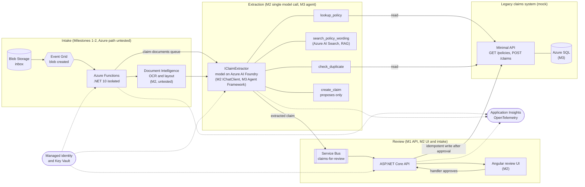

# Architecture

> Thames Mutual Insurance is a fictional customer. See [00-discovery.md](00-discovery.md).

This is the target architecture. Milestone 1 built the skeleton: the API, the legacy mock, the domain rules
and the infrastructure. Milestone 2 added the intake pipeline, the extractors, the review UI and the write-back
to the legacy system, and runs end to end on a laptop in a local mode ([ADR 0005](adr/0005-local-development-mode.md)).
Parts that are not built yet carry the milestone that adds them in their label. The table below the diagram
gives the status of each component, and the section after it shows how the two modes differ.

## Flow

Read the diagram left to right. A document lands in the inbox, an event starts the Function, the Function
sends the document for OCR and then to the extraction agent. The agent reads the policy, searches policy
wording, checks for duplicates and proposes a claim. The proposal goes to a queue. The API stores it and shows
it to a handler. Only the handler's approval causes the API to write to the legacy system.

## Components

| Component | Project | Status |
|---|---|---|
| Blob inbox, Event Grid | `infra/` | Storage account and container defined in Bicep. Event Grid subscription added after the first deployment. |
| Intake pipeline | `src/ClaimsIntake.Pipeline` | Built (M2). Host-free `ClaimIntakePipeline`: extract text, extract fields, `lookup_policy`, validate, hand off, one span per stage. |
| Intake Function | `src/ClaimsIntake.Functions` | Built (M2), never run. Blob trigger that calls the pipeline. |
| Local inbox watcher | `src/ClaimsIntake.Watcher`, `LocalInboxWatcher` | Built (M2). Local-mode stand-in for the blob trigger. |
| Document text | `LocalPdfTextExtractor`, `AzureDocumentIntelligenceExtractor` | Local reader built and tested. Document Intelligence version compiled and tested against a fake, never run. |
| Field extraction | `HeuristicClaimExtractor`, `FoundryLlmClaimExtractor` | Heuristic built and tested. Model version (`IChatClient`, JSON schema) tested against a fake chat client, never run. The agent and its tools are Milestone 3 ([ADR 0004](adr/0004-dotnet-agent-framework.md)). |
| Hand-off | `HttpClaimSink`, `ServiceBusClaimSink` | HTTP (local) built and run. Service Bus (Azure) compiled and tested against a fake sender, never run. |
| Domain and validation rules | `src/ClaimsIntake.Domain` | Built. Claim, fields with confidence and span, status, data-quality rules, `ProposedClaim` hand-off message. |
| Review API | `src/ClaimsIntake.Api` | Built, with an in-memory store: list, get, approve (writes to legacy), reject, intake route and Service Bus consumer, health checks, OpenTelemetry. |
| Review UI | `ui/` | Built (M2). Angular 21: claim list, claim detail with source text beside fields, approve or reject. |
| Mock legacy system | `src/ClaimsIntake.Legacy` | Built, in memory: `GET /policies/{number}`, `POST /claims` with an idempotency key. |
| Search of policy wording, duplicate check | | Not started (M3). |
| Infrastructure | `infra/`, `azure.yaml` | Written, not deployed or validated. M2 adds app settings only; Document Intelligence and Foundry resources are not in it yet. |

## Two modes, one pipeline

The same `ClaimIntakePipeline` runs in both modes. Only the edges differ, and they are chosen by `Intake:*`
configuration.

| | Local mode | Azure mode |
|---|---|---|
| Trigger | `LocalInboxWatcher` polls `./local-inbox` | Blob created, Event Grid, blob-trigger Function |
| Text | PdfPig (text PDFs), `.txt`, `.eml` | Document Intelligence `prebuilt-layout` |
| Fields | `HeuristicClaimExtractor` | `FoundryLlmClaimExtractor` (`IChatClient`) |
| Hand-off | `POST /intake/claims` on the API | `claims-for-review` Service Bus queue |
| Credentials | None | `DefaultAzureCredential`, a managed identity, no keys |
| Review store | In-memory, in the API | In-memory, in the API (durable store is future work) |

Both hand-offs carry the same `ProposedClaim` JSON and end in `ClaimIntakeService`, which derives the claim id
from the document id so a repeat is recognised.

## Approval and the write to the legacy system

1. A handler approves a claim in the UI. The API checks that the legacy system can take it (policy number,
   claimant, readable loss date and description are present) and that it has no blocking errors.
2. The claim moves to `Approved`, and the API posts it to the legacy system with `Idempotency-Key` set to the claim id.
3. On success the claim moves to `Submitted` and keeps the legacy reference.
4. If the legacy system fails or times out, the claim stays `Approved` and the API answers 502. Approving again
   sends the same key, so the legacy system either creates the claim or returns the one it already made. Approvals
   for one claim run one at a time, and a claim already `Submitted` is returned as it is.

## Trust boundaries and data flow

1. **Outside to inbox.** Documents come from brokers and are untrusted. They are treated as data, never as
   instructions. They are size-limited (10 MB) and type-checked at intake.
2. **Inbox to extractor.** The extractor sees document text. In M2 the model has no tools, its reply is
   validated against the document, and a value it cannot ground in the text has its confidence capped. In M3 the
   agent has read-only tools and `create_claim` cannot write to the legacy system
   ([ADR 0002](adr/0002-human-approval-for-writes.md)).
3. **Pipeline to review store.** Proposed claims carry fields, confidence, source spans, validation issues and
   the source text. The local HTTP route has no authentication and is off by default.
4. **Review to legacy.** The only write path. It needs an approval from a named handler and uses an
   idempotency key.
5. **Telemetry.** Traces and metrics carry identifiers and counts, never claim content or personal data.

## Cross-cutting

- **Identity:** a managed identity and RBAC for every service-to-service call, no keys
  ([ADR 0003](adr/0003-managed-identity-no-keys.md)).
- **Region:** UK South for all resources. The Bicep restricts the `location` parameter to `uksouth`.
- **Observability:** OpenTelemetry in the API and the watcher (console exporter by default, OTLP optional). The
  pipeline emits an `intake.<stage>` span per stage with `stage`, `duration_ms`, `documentId` and `confidence`, and
  never document text or field values. Application Insights is created in the infrastructure. Exporting to it,
  including the Function App's spans, is wired in Milestone 6.
- **Configuration:** settings name resources, not secrets. Key Vault is provisioned and empty.

## Deployment (not yet exercised)

`azd up` provisions a resource group with: a user-assigned managed identity, Log Analytics and Application
Insights, two storage accounts (inbox, and Function host), Service Bus with two queues, Key Vault, a Flex
Consumption Function App, and an App Service plan with the API and the legacy mock. The Bicep has not been
validated or deployed. See the README.
