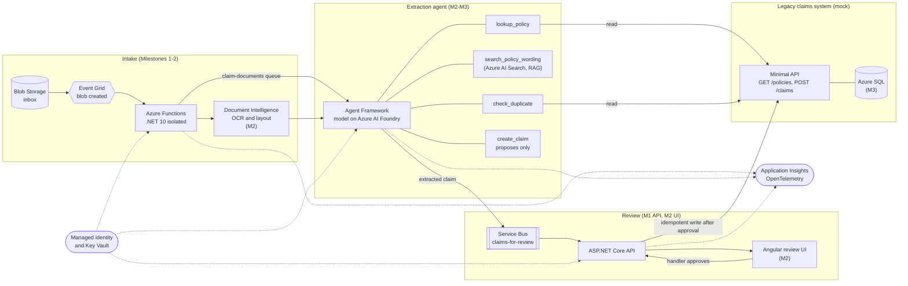

# Architecture

> Thames Mutual Insurance is a fictional customer. See [00-discovery.md](00-discovery.md).

This is the target architecture. Milestone 1 builds the skeleton: the Function stub, the API, the legacy
mock, the domain rules and the infrastructure. Parts that are not built yet carry the milestone that adds
them in their label. The table below the diagram gives the status of each component.

## Flow

Read the diagram left to right. A document lands in the inbox, an event starts the Function, the Function
sends the document for OCR and then to the extraction agent. The agent reads the policy, searches policy
wording, checks for duplicates and proposes a claim. The proposal goes to a queue. The API stores it and shows
it to a handler. Only the handler's approval causes the API to write to the legacy system.

## Components

| Component | Project | Milestone 1 status |
|---|---|---|
| Blob inbox, Event Grid | `infra/` | Storage account and container defined in Bicep. Event Grid subscription added after the first deployment (M2). |
| Intake Function | `src/ClaimsIntake.Functions` | Blob-trigger stub. Logs the document and puts a message on `claim-documents`. |
| Document Intelligence | | Not started (M2). |
| Extraction agent and tools | | Not started (M2, M3). See [ADR 0004](adr/0004-dotnet-agent-framework.md). |
| Domain and validation rules | `src/ClaimsIntake.Domain` | Built. Claim, fields with confidence and source span, status, data-quality rules. |
| Review API | `src/ClaimsIntake.Api` | Built, with an in-memory store: list, get, approve, reject, health checks, OpenTelemetry. |
| Review UI | | Not started (M2). |
| Mock legacy system | `src/ClaimsIntake.Legacy` | Built, in memory: `GET /policies/{number}`, `POST /claims` with an idempotency key. |
| Infrastructure | `infra/`, `azure.yaml` | Written, not deployed or validated. |

## Trust boundaries and data flow

1. **Outside to inbox.** Documents come from brokers and are untrusted. They are treated as data, never as
   instructions. They are size-limited and type-checked at intake (M2).
2. **Inbox to agent.** The agent sees document text. It has read-only tools. `create_claim` cannot write to
   the legacy system ([ADR 0002](adr/0002-human-approval-for-writes.md)).
3. **Agent to review store.** Proposed claims carry fields, confidence, source spans and validation issues.
4. **Review to legacy.** The only write path. It needs an approval from a named handler and uses an
   idempotency key.
5. **Telemetry.** Traces and metrics carry identifiers and counts, never claim content or personal data.

## Cross-cutting

- **Identity:** a managed identity and RBAC for every service-to-service call, no keys
  ([ADR 0003](adr/0003-managed-identity-no-keys.md)).
- **Region:** UK South for all resources. The Bicep restricts the `location` parameter to `uksouth`.
- **Observability:** OpenTelemetry in the API (console exporter by default, OTLP optional). Application
  Insights is created in the infrastructure. Exporting to it is wired in Milestone 6.
- **Configuration:** settings name resources, not secrets. Key Vault is provisioned and empty.

## Deployment (not yet exercised)

`azd up` provisions a resource group with: a user-assigned managed identity, Log Analytics and Application
Insights, two storage accounts (inbox, and Function host), Service Bus with two queues, Key Vault, a Flex
Consumption Function App, and an App Service plan with the API and the legacy mock. The Bicep has not been
validated or deployed. See the README.
